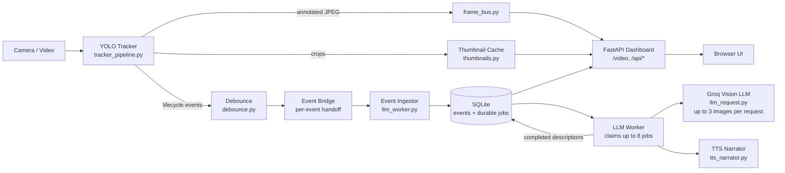

<div align="center">

# PRECEPT-AI

### Vision intelligence console: real-time object tracking, narrated by an LLM

*YOLO tracks it. Events describe it. A multimodal LLM explains it. A live dashboard shows it.*

<br>

[](https://www.python.org/)
[](https://docs.ultralytics.com/)
[](https://fastapi.tiangolo.com/)
[](https://www.sqlite.org/)
[](https://groq.com/)
[](https://opencv.org/)

<br>

[Overview](#overview) · [Features](#features) · [Architecture](#architecture) · [Quick Start](#quick-start) · [Dashboard](#dashboard) · [Design Decisions](#design-decisions) · [Roadmap](#roadmap)

</div>

---

## Overview

Precept watches a camera or video source, tracks objects with IDs maintained during each run, and turns **track lifecycle events** into natural-language descriptions using a multimodal LLM. Events, description jobs, and descriptions are persisted to SQLite and shown on a local, real-time browser dashboard, with queued speech narration.

Instead of sending every frame to an LLM (slow and expensive), Precept calls the model only when something meaningful happens: a new object becomes stable, or its appearance changes.

## Features

- **Per-run tracking.** Ultralytics YOLO maintains track IDs across frames during a run.
- **Event-based lifecycle.** `TRACK_NEW`, `TRACK_STABLE`, `TRACK_APPEARANCE_CHANGED` and `TRACK_EXITED`, debounced to avoid flicker.
- **Cost-aware LLM usage.** Descriptions are requested for stable or changed tracks, with up to 8 queued jobs claimed at a time and a capped completion size.
- **Multimodal descriptions.** Object crops are sent to a vision LLM on Groq, in groups of at most 3 images per call.
- **Live MJPEG video.** The browser receives video over one persistent stream; dashboard data APIs refresh separately.
- **Real-time dashboard.** Live feed, active targets, daily activity chart and recent visits.
- **In-memory active thumbnails.** Cached on the tracker thread, independently of LLM processing.
- **Durable SQLite processing.** Events, description jobs, and resized job crops are stored in WAL mode so pending work can be recovered after a restart.
- **Bounded provider retries.** Transient provider failures are retried with backoff; each job is limited to 5 attempts.
- **Speech narration.** `pyttsx3` consumes descriptions on a background thread.
- **Independent processing.** Tracking and video run separately from event persistence and LLM requests, so provider delays do not block the live feed.

## Architecture



| Stage | Responsibility |
|---|---|
| **Tracker** | Runs YOLO, publishes annotated frames, extracts crops, emits lifecycle events |
| **Debounce** | Turns noisy per-frame state into clean `NEW` / `STABLE` / `CHANGED` / `EXITED` events |
| **Event bridge** | Hands each event from the synchronous tracker to the async event ingestor |
| **Event ingestor** | Persists every event; creates a durable description job and crop for stable or changed tracks |
| **LLM worker** | Claims up to 8 due jobs, requests descriptions, stores results against their originating events, and queues narration |
| **LLM request** | Streams completions from Groq's `qwen/qwen3.8-27b` model, capped at 256 tokens and split into groups of at most 3 images |
| **Storage** | SQLite in WAL mode (`precept.db`), including event, description, and description-job data |
| **Dashboard** | FastAPI serving the MJPEG stream, JSON APIs and static UI |

## Quick Start

### Prerequisites

- Python 3.10+
- A webcam or video file
- A [Groq](https://console.groq.com) API key

### Install

```bash
git clone https://github.com/Ibtesam-Hussain/precept-ai.git
cd precept-ai

python -m venv venv
# Windows (PowerShell)
.\venv\Scripts\Activate.ps1
# macOS / Linux
source venv/bin/activate

pip install -r requirements.txt
```

### Configure

Create a `.env` file in the repository root (it is ignored by Git) and add your Groq API key:

```dotenv
GROQ_API_KEY=your-key-here
```

`llm_request.py` loads this file with `python-dotenv`; Groq also accepts the key through the `GROQ_API_KEY` environment variable.

### Run

```bash
python main.py --source 0 --visualize
```

Open **http://localhost:8000**.

| Flag | Description | Default |
|---|---|---|
| `--source` | Camera index or video path | `0` |
| `--model` | YOLO weights | `yolo26n.pt` |
| `--visualize` | Show the OpenCV debug window (`q` stops tracking) | off |
| `--dashboard-port` | Dashboard port | `8000` |

> Always run with the project's virtual environment so FastAPI and `pyttsx3` resolve from the same interpreter.

## Dashboard

| Endpoint | Purpose |
|---|---|
| `/` | Dashboard UI |
| `/video` | Continuous MJPEG stream (`multipart/x-mixed-replace`) |
| `/api/status` | Dashboard health and current UTC response timestamp |
| `/api/scene` | Active tracks with latest descriptions, filtered against the tracker's current live IDs |
| `/api/stats` | Today's new-track counts (people and other objects) and hourly activity |
| `/api/visits` | Up to 20 recent completed track visits with available descriptions |
| `/thumb/{track_id}` | In-memory JPEG crop (404 if unavailable) |

The UI connects to `/video` through a single `` and refreshes scene, stats, visits, and status on a 5-second interval (status is also checked every 15 seconds). Dynamic content is rendered as text rather than interpolated as HTML.

## Design Decisions

**Event-driven instead of frame-driven LLM calls.** Describing every frame would be slow and costly. Debouncing track state and calling the model only on meaningful transitions cuts calls by orders of magnitude.

**MJPEG for video, polling for dashboard data.** The browser keeps one long-lived `/video` connection for frames. Scene, stats, and visits are fetched from their JSON APIs every five seconds.

**Thumbnails decoupled from the LLM.** Crops are cached on the tracker thread when events are emitted, so a slow or failing LLM request never delays or loses a thumbnail.

**Live-ID filtering for the scene.** `/api/scene` is database-backed but filtered against the tracker's current active IDs, so tracks whose exit event is still queued don't appear as stale.

**Isolation of slow work.** The tracker and dashboard run separately from event ingestion and description processing. Provider rate limits can delay descriptions; transient failures are retried with exponential backoff starting at 5 seconds and growing to 300 seconds, subject to a longer numeric `Retry-After`, for up to five attempts per job. Speech runs on its own background thread.

## Known Limitations

- **No Re-ID.** A person who leaves and re-enters the frame gets a new track ID.
- **Provider availability.** Only transient connection, timeout, rate-limit, and selected server errors are retried. Other errors, or jobs that exhaust five attempts, are marked failed; the dashboard does not currently expose job status.
- **No visit-image history.** Active-target thumbnails are in memory and lost on restart. Persisted job crops support description processing but are not exposed as visit snapshots.
- **No automated tests** are currently included in the repository.
- **Prototype deployment.** The server binds to all network interfaces and has no authentication; do not expose it to untrusted networks.
- **FPS is hardware-bound.** Throughput depends on camera, YOLO model size, input resolution and inference hardware.

## Roadmap

- [ ] Add automated tests for event persistence, job recovery, retry behavior, and delayed descriptions
- [ ] Show pending, retrying, and failed description-job status in the dashboard
- [ ] Add retention/cleanup for completed and failed description jobs and stored crops
- [ ] Per-visit crop snapshots for durable visual history
- [ ] Alerts and zone-based triggers
- [ ] Escalation tier: a stronger model judges flagged events
- [ ] Natural-language query over event history
- [ ] Docker packaging and config file
- [ ] Dashboard upgrade: HUD overlay, event ticker, timeline scrubber

## Project Structure

```text
precept-ai/
├── README.md               # Overview, setup, architecture, and roadmap
├── main.py                 # Process orchestration and CLI
├── tracker_pipeline.py     # YOLO frame loop and frame publication
├── frame_bus.py            # Latest encoded frame shared with the web server
├── debounce.py             # Track state → lifecycle events
├── track_events.py         # Event definitions
├── event_queue.py          # Per-event tracker-to-ingestor handoff
├── llm_worker.py           # Event ingestion, durable jobs, and descriptions
├── llm_request.py          # Groq image batching and streaming
├── storage.py              # SQLite events, descriptions, and durable jobs
├── thumbnails.py           # In-memory crop cache
├── tts_narrator.py         # Background speech output
├── interface/
│   ├── __init__.py         # Dashboard package
│   ├── dashboard.py        # FastAPI routes and MJPEG response
│   └── static/             # Dashboard HTML, CSS, JS
├── contextforclaude.md     # Current project context
├── engineering-101.md      # Engineering notes and historical addenda
├── requirements.txt        # Python dependencies
└── .gitignore
```

## Author

**Ibtesam Hussain**, AI Engineer, Karachi, Pakistan

<div align="center">

<br>

*Built to turn raw video into something you can read.*

</div>